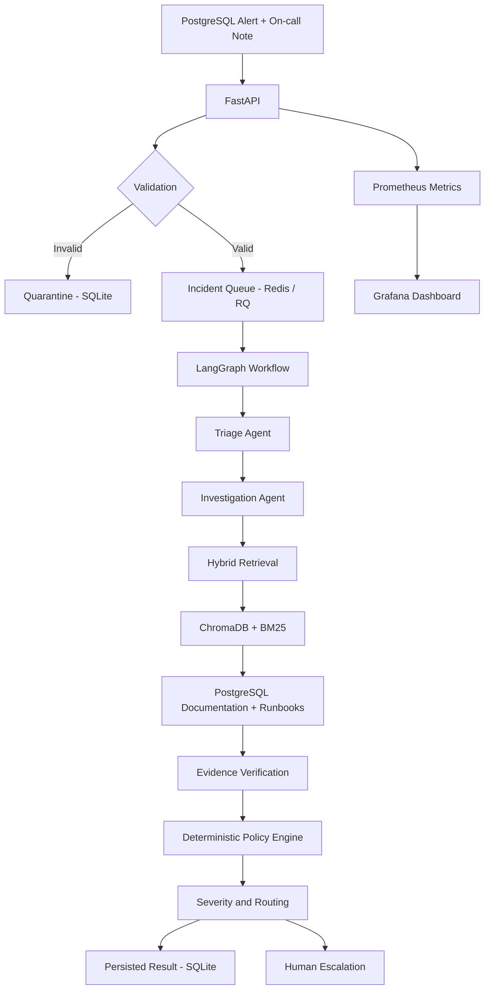

# Production Incident Triage & Runbook Assistant

An AI-assisted PostgreSQL incident investigation system that processes alerts, retrieves relevant technical documentation, investigates potential root causes, verifies supporting evidence, and recommends incident severity and escalation routes.

Built as a multi-agent systems project using FastAPI, LangGraph, hybrid retrieval, Redis, ChromaDB, and Prometheus/Grafana.

**It is designed for safe incident investigation, not automatic remediation. It never executes SQL modifications or changes database infrastructure.**

## Project Information

- **Course:** UE24AM342AA5 – Mini Project 08
- **Team Members:**
  - Huma Wahid – PES2UG24AM066
  - Neeraj – PES2UG24AM046
  - Jaswanth – PES2UG24AM068
- **Repository:** https://github.com/Huma13/incident-triage

## Problem Statement

PostgreSQL incidents often require engineers to investigate alerts, correlate metrics, search documentation, identify possible causes, and determine escalation priorities.

This project automates much of that investigation workflow by combining structured incident validation, retrieval-augmented investigation, evidence verification, and deterministic policy evaluation.

## System Architecture



## Key Features

### 1. Incident ingestion and validation
- REST API built with FastAPI.
- Pydantic-based incident schema validation.
- Payload size limits.
- Duplicate incident detection using source event IDs.
- Invalid incidents stored in a quarantine table.
- SQLite persistence for incident runs and results.

### 2. Asynchronous processing
- Redis-backed job queue using RQ.
- Background incident processing.
- Unique run identifiers.
- Persistent processing results and status tracking.

### 3. Multi-agent investigation
- LangGraph-based sequential workflow.
- Triage and investigation agents.
- Structured investigation state.
- Evidence verification and policy evaluation.

### 4. Hybrid retrieval
- ChromaDB vector search.
- BM25 keyword retrieval.
- Reciprocal Rank Fusion for combining results.
- Sentence Transformers embeddings.
- PostgreSQL 17 documentation and custom runbooks.

### 5. Evidence verification and safety
- Citation and source-path verification.
- Evidence substring validation.
- Rejection of unsupported evidence.
- Deterministic severity and routing policies.
- Human escalation when evidence is insufficient or investigation cannot safely classify an incident.

### 6. Observability
- Prometheus metrics exposed through `/metrics`.
- HTTP request counters.
- Request-duration histograms.
- Incident submission counters.
- Grafana dashboard with:
  - Incident submissions by outcome.
  - HTTP request rate.
  - API request latency (p95).
  - Total incidents by outcome.

## Technology Stack

| Component | Technology |
|---|---|
| Backend API | Python, FastAPI |
| Data validation | Pydantic |
| Agent orchestration | LangGraph |
| Background jobs | Redis, RQ |
| Vector database | ChromaDB |
| Keyword retrieval | BM25 |
| Embeddings | Sentence Transformers |
| Persistence | SQLite |
| Monitoring | Prometheus |
| Dashboards | Grafana |
| Deployment | Docker, Docker Compose |

## Getting Started

### Prerequisites

- macOS, Linux, or Windows with WSL
- Docker Desktop
- Git

### 1. Clone the repository

```bash
git clone https://github.com/Huma13/incident-triage.git
cd incident-triage
```

### 2. Configure environment

```bash
cp .env.example .env
```

Review the environment configuration.

The current Docker Compose worker configuration enables stub mode (`USE_LLM_STUB=true`) for reproducible local testing. A configured live LLM provider is not required for this mode.

### 3. Start the application

```bash
docker compose up --build -d
```

Check the running services:

```bash
docker compose ps
```

### 4. Verify API health

```bash
curl http://127.0.0.1:8001/health
```

Expected response:

```json
{
  "status": "ok"
}
```

## API Usage

### Submit an incident

The repository includes a sample incident at `evaluation/case_4_1.json`.

```bash
curl -X POST http://127.0.0.1:8001/api/v1/runs \
  -H "Content-Type: application/json" \
  --data-binary @evaluation/case_4_1.json
```

The API returns a run ID and links to the status and result endpoints.

### Check incident status

```bash
curl http://127.0.0.1:8001/api/v1/runs/<run_id>
```

### Retrieve the investigation result

```bash
curl http://127.0.0.1:8001/api/v1/runs/<run_id>/result
```

The result includes investigation findings, verified evidence, severity classification, routing recommendations, and escalation information where applicable.

### Available endpoints

| Method | Endpoint | Purpose |
|---|---|---|
| GET | `/health` | API and Redis health |
| POST | `/api/v1/runs` | Submit an incident |
| GET | `/api/v1/runs/{run_id}` | Retrieve incident status |
| GET | `/api/v1/runs/{run_id}/result` | Retrieve investigation result |
| GET | `/metrics` | Prometheus metrics |

## Monitoring Dashboard

The monitoring stack is provisioned through Docker Compose.

| Service | URL |
|---|---|
| API | http://localhost:8001 |
| Prometheus | http://localhost:9091 |
| Grafana | http://localhost:3001 |

### Grafana setup

1. Open http://localhost:3001.
2. Log in with the initial credentials `admin` / `admin` if prompted.
3. Change the initial password.
4. Navigate to Dashboards.
5. Open **Incident Triage → Incident Triage Monitoring**.

Prometheus scrapes the API metrics endpoint every five seconds.

## Testing

Run the automated test suite inside the API container:

```bash
docker compose exec api python -m pytest -q
```

**Latest verified test result: 17 passed.**

Test coverage includes:

- Incident schema validation.
- Incident submission and queueing.
- Invalid incident quarantine.
- Duplicate submission handling.
- Oversized payload rejection.
- Unknown run handling.
- Result readiness handling.
- Severity and routing policy evaluation.

## Evaluation Scenario

The included reference scenario, `evaluation/case_4_1.json`, models a PostgreSQL primary disk-usage incident.

The expected investigation considers:

- Increasing primary disk usage.
- Stable table and index sizes.
- Replication slots retaining WAL.

The expected classification is:

| Attribute | Expected result |
|---|---|
| Cause class | `data_volume` |
| Hypothesis | `replication_slot_retaining_wal` |
| Severity | `SEV2` |
| Routing | `page-secondary` |

The end-to-end reference scenario has been tested through the API, Redis/RQ worker, LangGraph workflow, retrieval, evidence verification, policy evaluation, and result persistence.

## Project Structure

```text
incident-triage/
│
├── agents/
│   ├── worker.py
│   ├── graph.py
│   ├── state.py
│   ├── triage.py
│   ├── investigator.py
│   └── evidence.py
│
├── api/
│   ├── main.py
│   └── schemas.py
│
├── corpus/
│   ├── postgresql_docs/
│   ├── runbooks/
│   └── policy/
│
├── evaluation/
│   └── case_4_1.json
│
├── policies/
│   └── engine.py
│
├── retrieval/
│   ├── hybrid.py
│   └── citation_verifier.py
│
├── monitoring/
│   ├── prometheus.yml
│   └── grafana/
│       ├── dashboards/
│       └── provisioning/
│
├── tests/
│   ├── test_api.py
│   ├── test_contract.py
│   └── test_policy.py
│
├── docs/
├── Dockerfile
├── docker-compose.yml
├── requirements.txt
└── README.md
```

## Current Limitations

- The current Docker Compose configuration uses an LLM stub for reproducible local execution; live LLM integration requires provider configuration and separate validation.
- The reference corpus focuses on PostgreSQL 17.
- The current evaluation suite contains a limited set of automated test cases.
- Monitoring currently focuses on API-level metrics rather than comprehensive worker, Redis, and ChromaDB telemetry.
- Investigation recommendations require human review; automated remediation is intentionally excluded.

## Future Improvements

- Live LLM provider integration and structured-output validation.
- Expanded incident evaluation benchmarks.
- Worker and retrieval latency monitoring.
- Alerting for failed investigations and service degradation.
- More PostgreSQL versions and additional database runbooks.
- Improved investigation confidence scoring and evidence entailment verification.

---

**Project focus:** AI-assisted infrastructure reliability, multi-agent orchestration, retrieval-augmented investigation, evidence-grounded decision-making, and production-oriented observability.
